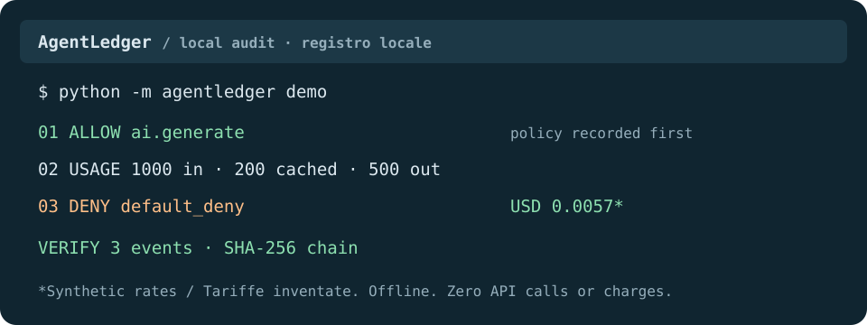

# AgentLedger

Registro locale per agenti AI: autorizzazioni, consumo di token e calcoli di costo riproducibili.

[English](README.md) · [Release alfa](https://github.com/MRJonam91/AgentLedger/releases) · [Architettura](docs/ARCHITECTURE.md)



**0.1.0a1 — alfa locale utilizzabile.** Python 3.11+, Windows/Linux/macOS, nessuna dipendenza di esecuzione. Interfaccia da terminale. Validazione con utenti esterni e prova a pagamento con il provider ancora da eseguire: [verifiche](docs/VERIFICATION.md).

## Provala senza account

Dalla cartella del progetto:

```sh
python -m agentledger demo
python -m agentledger report --format markdown
python -m agentledger verify
```

La demo offline registra una richiesta autorizzata, 1.000 token in ingresso (200 in cache), 500 in uscita e una richiesta negata. **USD 0,0057 è un calcolo sintetico con tariffe inventate: nessuna chiamata e nessun addebito.** Ripetere la demo aggiunge un'altra prova. I dati restano in `.agentledger/ledger.sqlite3`, rispetto alla cartella corrente.

Installa la CLI dal sorgente con `python -m pip install .`, oppure scarica il wheel dalla release e usa `python -m pip install ./agentledger_local-0.1.0a1-py3-none-any.whl`. Il comando installato è `agentledger`. Il pacchetto è distribuito tramite GitHub Releases, non PyPI.

## Raccogli una risposta reale

```sh
python -m agentledger --db .agentledger/imports.sqlite3 import-response examples/response.json --rates examples/rates.demo.json
python -m agentledger --db .agentledger/imports.sqlite3 report
```

Sostituisci il file di esempio con un oggetto **OpenAI Responses API** salvato localmente. L'esempio è sintetico. Il collettore conserva solo contatori, modello/stato e digest SHA-256 dell'ID della risposta. Scarta testo, prompt, header e campi aggiuntivi. Le importazioni sono marcate `imported`: origine e veridicità non sono autenticate. ID già presenti nello stesso database vengono rifiutati; reimportare non modifica le tariffe già registrate. I file originali restano sotto la tua responsabilità.

Senza `--rates`, il consumo viene registrato **senza prezzo**. Adatta la scheda di esempio al **modello esatto restituito** e alle tariffe USD per milione di token applicabili; indica la data di validità. Un modello diverso resta senza prezzo. Le tariffe sono dichiarazioni dell'utente, non listini verificati automaticamente. Ogni evento con prezzo conserva scheda e hash. L'ingresso in cache non viene contato due volte:

```text
USD = ((ingresso - cache) × tariffa_ingresso + cache × tariffa_cache + uscita × tariffa_uscita) / 1.000.000
```

I report separano `demo`, `imported` e `live`; gli importi sono **subtotali del consumo con prezzo**, escludendo eventi senza tariffa, esiti ignoti, chiamate pendenti, costi di tool/immagini/audio e imposte. La riconciliazione con le fatture non rientra nell'alfa.

## Esegui l'agente minimo

`run` invia una singola richiesta di generazione testuale a OpenAI. Legge un prompt UTF-8 da stdin e `OPENAI_API_KEY` dall'ambiente. Restituisce la contabilità e scarta il testo generato. Non esegue tool generici o cicli autonomi.

Crea un `policy.json` privato partendo da `examples/policy.demo.json`: sostituisci `demo-model` con un modello disponibile scelto da te e imposta il limite dei token in uscita. Configura tariffe reali corrispondenti se desideri il calcolo. Con la chiave già nell'ambiente:

```sh
python -m agentledger run --model YOUR_MODEL --policy policy.json --max-output-tokens 512 < prompt.txt
```

PowerShell 7: `Get-Content -Raw -Encoding utf8 prompt.txt | python -m agentledger run --model YOUR_MODEL --policy policy.json`. Con PowerShell precedente imposta `$OutputEncoding = [System.Text.UTF8Encoding]::new()`. Tieni le chiavi fuori dalla cronologia e dalla repository. Una richiesta reale può comportare addebiti del provider. Non esiste un tetto monetario.

Senza policy la richiesta è negata. Modello esatto e limite richiesto devono superare il controllo prima dell'accesso alla rete; la decisione viene prima salvata su disco. Nessun retry o redirect automatico. Risposte fallite o malformate producono `unknown`, non costo zero; chiamate interrotte risultano pendenti. L'adapter usa `store=false`; la conservazione lato provider è distinta dal registro locale ([controlli ufficiali sui dati](https://developers.openai.com/api/docs/guides/your-data)).

## Esporta e verifica

```sh
python -m agentledger report > report.json
python -m agentledger report --format markdown > report.md
python -m agentledger verify --expected-head SAVED_64_CHARACTER_HASH
```

Conserva il `checkpoint` del report separatamente. L'ultimo comando richiede che la testa del registro sia invariata; anche nuove aggiunte legittime la cambiano. La catena di hash rileva modifiche agli eventi; un checkpoint esterno fidato rileva cancellazione della coda o sostituzione. **Senza checkpoint esterno, riscrivere l'intera catena o cancellarne la coda può superare la verifica.** Il database è in chiaro, protetto dai permessi del filesystem/account, non cifrato e non è una sandbox del sistema operativo. Altri agenti possono aggirare l'adapter: [modello di minaccia](docs/THREAT_MODEL.md).

Limiti: JSON ≤ 2 MiB, prompt ≤ 64 KiB, risposta ≤ 2 MiB, timeout HTTP 60 secondi. Supportato solo consumo testuale Responses con stato completed/incomplete; consumo mancante e fatturazione cache-write vengono rifiutati. I comandi di lettura rifiutano database assenti o corrotti. Codici di uscita: `0` completato, `2` errore locale/input o richiesta non inviata, `3` policy nega, `4` esito incompleto/ignoto. Errori JSON su stderr, risultati JSON su stdout salvo selezione Markdown. Gli errori degli argomenti restituiscono il codice JSON fisso `invalid_arguments_use_help`.

## Sviluppa ed estendi

```sh
python -m unittest discover -s tests -v
python scripts/check_project.py
python -m pip install build mypy
python -m mypy --check-untyped-defs agentledger
python -m build
```

I test usano database temporanei isolati e non contattano provider a pagamento. Nei sandbox Windows restrittivi imposta `TEMP`/`TMP` su una cartella già esistente dentro il checkout. [Design e piano](docs/superpowers/specs/2026-10-23-alpha-design.md), [architettura](docs/ARCHITECTURE.md), [schema](docs/EVENTS.md), [roadmap](docs/ROADMAP.md), [contributi](CONTRIBUTING.md), [supporto](SUPPORT.md) e [sicurezza](SECURITY.md) impostano i successivi passi di analisi, design e implementazione. Integrazioni TokenWatch/OpenAgentOS e dashboard sono sviluppi futuri.

## Licenza e attribuzioni

Copyright 2026 MRJonam91. [GPL-3.0-or-later](LICENSE), inclusi documenti e SVG originali. [Licenze](LICENSING.md), [avvisi](NOTICE), [inventario terze parti](THIRD_PARTY_NOTICES.md). La licenza software non concede nomi di progetto o marchi altrui; nessuna affiliazione con OpenAI. Il [seed](SEED.md) originale conserva la provenienza dell'idea.

## Sostieni il progetto

Se il progetto ti è utile, puoi sostenerne manutenzione e sviluppo tramite il pulsante Sponsor della repository, [GitHub Sponsors](https://github.com/sponsors/MRJonam91), [Ko-fi](https://ko-fi.com/mrjonam), [Buy Me a Coffee](https://buymeacoffee.com/mrjonam) o [PayPal](https://paypal.me/manorollo). Il supporto è volontario e non attribuisce licenze o diritti aggiuntivi.
