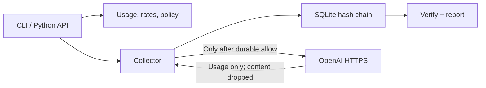

# Architecture / Architettura

EN: A local process reads input, validates it, records a decision before provider contact, normalizes usage and appends a hashed event. Verified reports are reconstructed from immutable event payloads. No background service, server, telemetry or auto-updater exists.

IT: Un processo locale legge e valida gli input, registra la decisione prima di contattare il provider, normalizza i consumi e aggiunge un evento con hash. I report verificati vengono ricostruiti dai payload degli eventi. Nessun servizio in background, server, telemetria o aggiornamento automatico.

| Module / Modulo | Responsibility / Responsabilità | Extension seam / Punto di estensione |
|---|---|---|
| `domain.py` | Strict schema, integer usage, Decimal cost, policy / Schema, consumi, costo, policy | Add a versioned normalization contract / Aggiungere contratto versionato |
| `storage.py` | Transactional append, schema checks, chain verification / Append, schema, verifica | Explicit migration required / Migrazione esplicita |
| `provider.py` | Bounded single HTTPS request / Singola richiesta limitata | Inject transport for tests / Transport sostituibile nei test |
| `service.py` | Decisions, collection, source-separated totals / Decisioni, raccolta, totali separati | Collector accepts normalized provider response / Contratto collettore |
| `cli.py` | Bounded files/stdin, JSON or Markdown output / File e stdin limitati, output | Thin command layer / Livello comandi sottile |

EN: Start from the specification and implementation plan under `docs/superpowers/`. For another provider first define trustworthy counter semantics, missing-usage behavior, cache accounting and identifier minimization; add failing tests before an adapter. Do not silently treat arbitrary OpenAI-compatible APIs as identical. For TokenWatch/OpenAgentOS, design an explicit run correlation and permission-evidence adapter before importing their logs; their READMEs were inspected, but no integration or runtime interoperability was tested.

IT: Parti da specifica e piano sotto `docs/superpowers/`. Per un altro provider definisci prima significato dei contatori, gestione del consumo assente, cache e minimizzazione degli identificatori; aggiungi test prima dell'adapter. Non trattare automaticamente tutte le API compatibili OpenAI come identiche. Per TokenWatch/OpenAgentOS progetta correlazione delle esecuzioni ed evidenza dei permessi prima di importare log; i README sono stati esaminati, ma integrazione e interoperabilità non sono state provate.

EN: Beta batches stream and verify all historical hashes once per write transaction, then append prepared events atomically. Single appends still scan the full history; there is no integrity-cache bypass. Verification does not retain historical events; reports materialize O(n) events to preserve whole-run context. `jsonio.py` shares strict bounded JSON/JSONL decoding across file/provider boundaries and exclusive output creation. Inspection uses read-only SQLite. Backup copies one verified SQLite read snapshot and verifies its resulting count/head. No rotation, migration or automatic restore is shipped. Connections close after operations; keep private backups/checkpoints outside Git. Default database location follows the working directory.

IT: I batch beta verificano in streaming tutti gli hash storici una volta per transazione e aggiungono atomicamente gli eventi preparati. Gli append singoli scansionano ancora tutta la storia; nessuna cache aggira l'integrità. La verifica non trattiene eventi storici; i report materializzano O(n) eventi per mantenere il contesto delle esecuzioni. `jsonio.py` condivide parsing rigoroso JSON/JSONL e creazione esclusiva dei file. L'ispezione usa SQLite di sola lettura. Il backup copia uno snapshot verificato e controlla testa/numero della copia. Nessuna rotazione, migrazione o ripristino automatico. Connessioni chiuse dopo le operazioni; conserva backup/checkpoint privati fuori da Git. Il database predefinito segue la cartella corrente.
